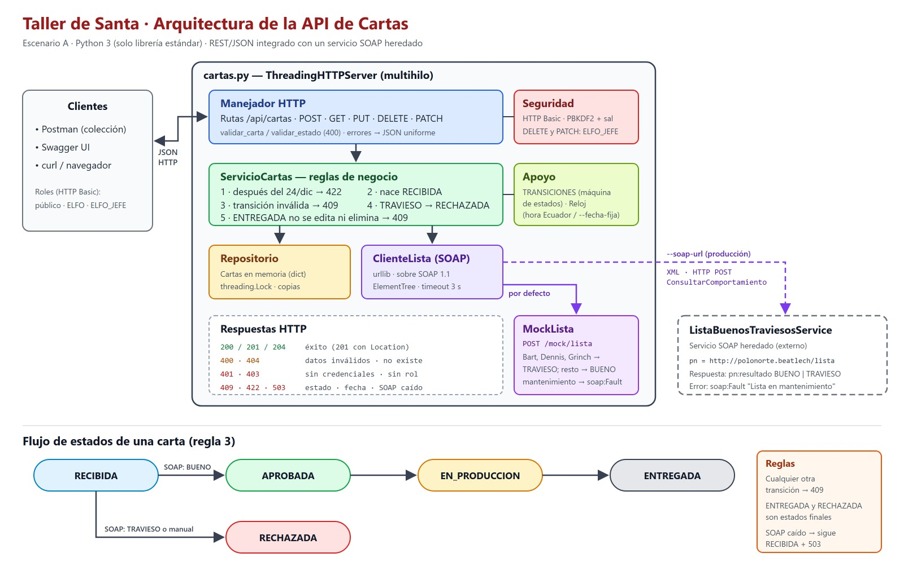

# Taller de Santa · API de Cartas (Escenario A)

API REST para registrar cartas a Santa y llevarlas por el flujo **aprobación → producción → entrega**. Antes de aprobar una carta, consulta el servicio SOAP heredado **ListaBuenosTraviesosService**.

**Stack:** solo **Python 3.9+ con su librería estándar**. No hay que instalar nada: ni pip, ni Maven, ni npm.

| Pieza | Módulo estándar |
|---|---|
| Servidor HTTP multihilo | `http.server.ThreadingHTTPServer` |
| JSON | `json` |
| Cliente SOAP | `urllib.request` (POST del sobre) + `xml.etree.ElementTree` (lectura de la respuesta) |
| Seguridad HTTP Basic | `base64`, `hashlib.pbkdf2_hmac`, `hmac.compare_digest` |
| Fechas | `datetime` (Ecuador = UTC-5 fijo) |
| Pruebas | `unittest` |

---

## 1. Archivos

```
escenario a/
├── cartas.py                 ← toda la API (servidor, reglas, cliente SOAP, simulador SOAP)
├── test_cartas.py            ← 15 pruebas automáticas
├── README.md                 ← esta guía
├── docs/
│   ├── openapi.json          ← especificación OpenAPI 3 (la sirve /v3/api-docs)
│   ├── arquitectura.png      ← diagrama de arquitectura y flujo de estados
│   ├── cartas-santa.postman_collection.json
│   └── GUION_SUSTENTACION.md
└── .vscode/
    ├── launch.json           ← F5: iniciar API / demo 24 dic / pruebas
    └── settings.json         ← activa las pruebas en la pestaña Testing
```

---

## 2. Cómo ejecutarlo

**Desde VS Code** (con la extensión *Python* de Microsoft):

1. *File → Open Folder* → `escenario a`.
2. Pestaña *Run and Debug* (Ctrl+Shift+D) → elegir **"Cartas: iniciar API (puerto 8080)"** → F5.
3. Las pruebas están en la pestaña *Testing* (matraz), o en *Run and Debug* → **"Cartas: correr pruebas"**.

**Desde la terminal** (en la carpeta `escenario a`):

```powershell
python cartas.py
```

```powershell
python -m unittest -v
```

Para demostrar la regla del 24 de diciembre sin cambiar la hora del PC, abre una segunda instancia en otro puerto:

```powershell
python cartas.py --puerto 8081 --fecha-fija 2026-12-25
```

| Recurso | URL |
|---|---|
| API | http://localhost:8080/api/cartas |
| Swagger UI | http://localhost:8080/swagger-ui.html (carga Swagger desde internet; sin conexión usa `docs/openapi.json`) |
| OpenAPI JSON | http://localhost:8080/v3/api-docs |
| Simulador SOAP | `POST http://localhost:8080/mock/lista` |

**Usuarios de demo (HTTP Basic):**

| Usuario | Clave | Rol |
|---|---|---|
| `elfojefe` | `polonorte` | `ELFO_JEFE` |
| `elfo` | `elfo1234` | `ELFO` (sirve para mostrar el 403) |

Opciones: `--puerto`, `--fecha-fija AAAA-MM-DD`, `--soap-url URL` (el servicio SOAP real; por defecto se usa el simulador). También se pueden pasar como variables de entorno `PUERTO`, `FECHA_FIJA` y `SOAP_LISTA_URL`.

---

## 3. Arquitectura



*Diagrama completo: componentes, integración SOAP, códigos HTTP y flujo de estados de una carta (archivo `docs/arquitectura.png`).*

Versión resumida en texto:

Todo está en `cartas.py`, separado en capas:

```
Cliente (Postman / Swagger / curl)
        │  JSON sobre HTTP
        ▼
Manejador (http.server) ── rutas, seguridad, errores JSON
        │
        ▼
ServicioCartas ── reglas 1 a 5 ──► Repositorio (memoria, thread-safe)
        │
        │  SOAP 1.1 / XML sobre HTTP
        ▼
ClienteLista ──► ListaBuenosTraviesosService  (real con --soap-url, o MockLista en /mock/lista)
```

| Clase o función | Responsabilidad |
|---|---|
| `Manejador._despachar` | Enrutador: decide qué hacer según el método y la ruta, y convierte `ApiError` en el JSON de error |
| `validar_carta`, `validar_estado` | Validación de entrada (400 con el detalle de cada campo) |
| `ServicioCartas` | Reglas de negocio. Es el único lugar donde se decide qué está permitido |
| `TRANSICIONES`, `puede_pasar` | La máquina de estados, en un solo lugar |
| `Repositorio` | Persistencia en memoria con candado (el servidor es multihilo) |
| `ClienteLista`, `construir_sobre`, `interpretar_respuesta` | Cliente SOAP: arma el sobre, lo envía y lee `pn:resultado` o `soap:Fault` |
| `MockLista` | Simulador del servicio SOAP |
| `autenticar`, `_requiere_rol` | HTTP Basic y control por rol |
| `Reloj` | Fecha del negocio (hora de Ecuador) o fecha fija para la demo |

El servidor es **multihilo** a propósito: mientras atiende un PATCH puede responderse a sí mismo la consulta SOAP del simulador.

---

## 4. Cumplimiento de requisitos (trazabilidad)

### Recurso `Carta`

| Campo | Regla del enunciado | Dónde se cumple |
|---|---|---|
| `id` | generado por el servidor | `Repositorio.guardar`. Si el cliente lo envía, se ignora |
| `remitente` | obligatorio, de 2 a 60 caracteres | `validar_carta` |
| `edad` | obligatorio, entero entre 1 y 17 | `validar_carta` (rechaza decimales y `true`/`false`) |
| `ciudad` | obligatorio | `validar_carta` |
| `regalos` | de 1 a 5, sin duplicados | `validar_carta` (los duplicados se comparan sin mayúsculas ni espacios) |
| `estado` | enum de 5 valores | `ESTADOS` |
| `comportamiento` | lo llena el sistema | Nace `PENDIENTE_VERIFICACION` y solo lo cambia la consulta SOAP |
| `fechaRecepcion` | generada por el servidor | `Reloj.ahora_iso()` en `registrar` |

### Reglas de negocio

| # | Regla | Implementación | Respuesta |
|---|---|---|---|
| 1 | No se aceptan cartas después del 24 de diciembre | `ServicioCartas.registrar` → `despues_de_nochebuena` | **422** |
| 2 | Toda carta nace `RECIBIDA` | `registrar` fija el estado; el cliente no puede enviarlo | 201 |
| 3 | Solo `RECIBIDA→APROBADA/RECHAZADA`, `APROBADA→EN_PRODUCCION` y `EN_PRODUCCION→ENTREGADA` | `TRANSICIONES` + `cambiar_estado` | **409** |
| 4 | Para pasar a `APROBADA` se consulta el SOAP; si dice `TRAVIESO`, la carta pasa a `RECHAZADA` | `cambiar_estado` → `ClienteLista.consultar_comportamiento` | 200 con estado `RECHAZADA` |
| 5 | Una carta `ENTREGADA` no se modifica ni elimina | `editar` y `eliminar` | **409** |

**Decisión de diseño: si el SOAP falla** (`soap:Fault` "Lista en mantenimiento", timeout o servicio caído). Una carta no puede aprobarse sin verificar, así que **se queda en `RECIBIDA`**, se guarda `comportamiento = PENDIENTE_VERIFICACION` y la API responde **503 Service Unavailable** para que el elfo reintente.

### Endpoints

| Método | Ruta | Seguridad | Éxito | Errores |
|---|---|---|---|---|
| POST | `/api/cartas` | pública | 201 + `Location` | 400, 422 |
| GET | `/api/cartas?estado=&ciudad=` | pública | 200 | 400 (estado inválido) |
| GET | `/api/cartas/{id}` | pública | 200 | 400, 404 |
| PUT | `/api/cartas/{id}` | pública | 200 | 400, 404, 409 |
| DELETE | `/api/cartas/{id}` | `ELFO_JEFE` | 204 | 401, 403, 404, 409 |
| PATCH | `/api/cartas/{id}/estado` | `ELFO_JEFE` | 200 | 400, 401, 403, 404, 409, 503 |

Todos los errores usan el mismo formato:

```json
{ "timestamp": "2026-12-10T12:00:00-05:00", "status": 409, "error": "Conflict",
  "mensaje": "Transición no permitida: RECIBIDA → ENTREGADA. Desde RECIBIDA solo se permite: APROBADA, RECHAZADA",
  "ruta": "/api/cartas/1/estado" }
```

En los 400 de validación se añade `detalles`, con el error de cada campo.

### Integración SOAP

- Operación `ConsultarComportamiento`, SOAP 1.1, namespace `http://polonorte.beatlech/lista`, `Content-Type: text/xml` y cabecera `SOAPAction`.
- Timeout de 3 s. Un `soap:Fault` llega con HTTP 500: el cliente lee el cuerpo igual y extrae `faultstring`.
- Los valores enviados se escapan (`&`, `<`, `>`…) para no romper el XML, y se rechazan respuestas con `DOCTYPE` (protección XXE).
- **Simulador (`/mock/lista`):** responde `TRAVIESO` para Bart, Dennis y Grinch, y `BUENO` para el resto. `POST /mock/lista/mantenimiento?activo=true` lo pone a devolver el `soap:Fault`, y `activo=false` lo restablece.

---

## 5. Pruebas

`python -m unittest -v` → **15 pruebas, 0 fallos**. Levantan el servidor real y hablan con el simulador SOAP por HTTP de verdad:

- **`ApiCartasTest`:**
  - creación con los datos que pone el servidor;
  - validaciones 400 (incluidos duplicados, edad decimal y JSON roto);
  - filtros, 404 y 400 por id;
  - flujo completo con `BUENO`, transiciones 409 y regla 5;
  - `TRAVIESO` → `RECHAZADA`;
  - `soap:Fault` → 503, la carta queda pendiente y luego se reintenta;
  - edición en `RECIBIDA`;
  - seguridad 401/403/204.
- **`FueraDePlazoTest`:** el 25 de diciembre da 422, y los límites 24/25 de diciembre y 1 de enero.
- **`SoapYEstadosTest`:** lectura de `BUENO`/`TRAVIESO`, `soap:Fault`, servicio caído, escape XML y máquina de estados.

**Postman:** importar `docs/cartas-santa.postman_collection.json` y ejecutarla con el *Runner*, en orden, con la API recién arrancada (los datos están en memoria). Son 21 peticiones con verificaciones.

---

